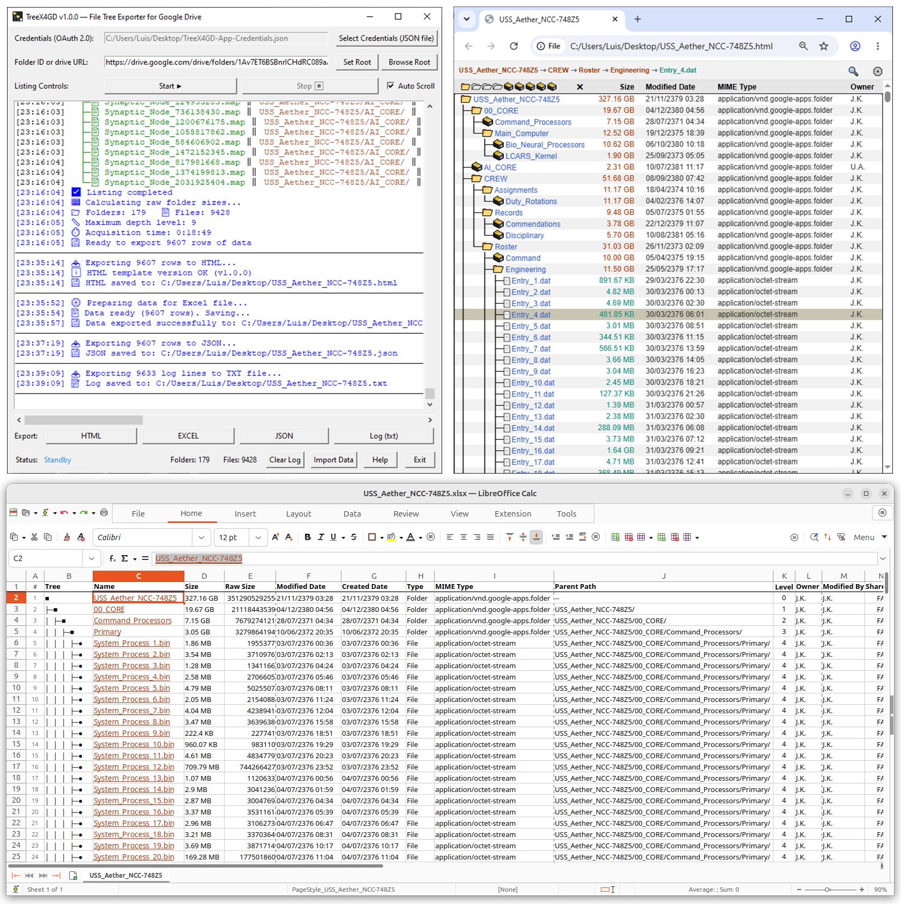
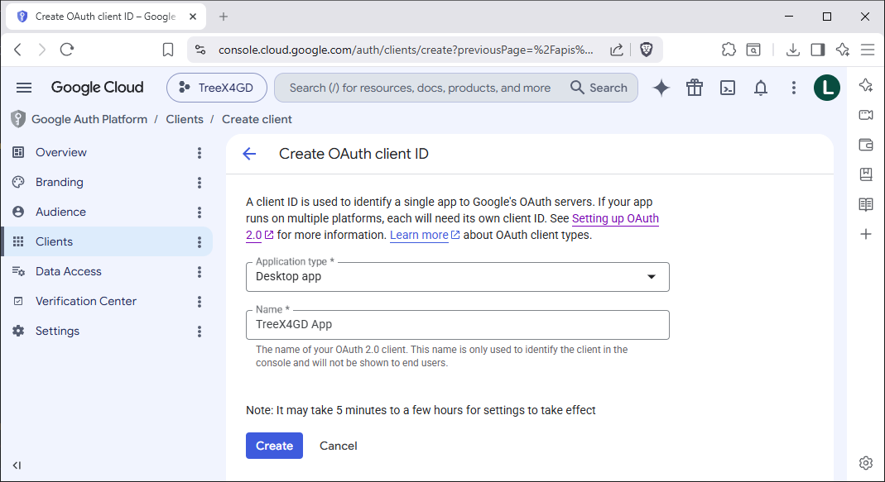
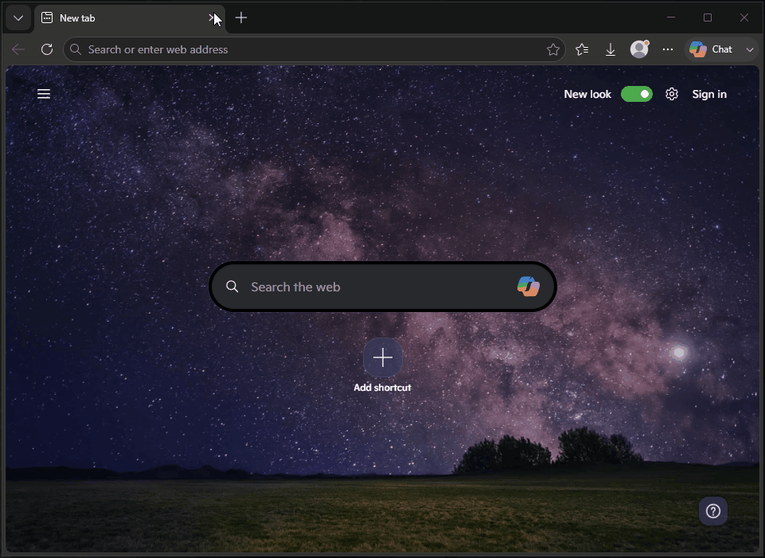
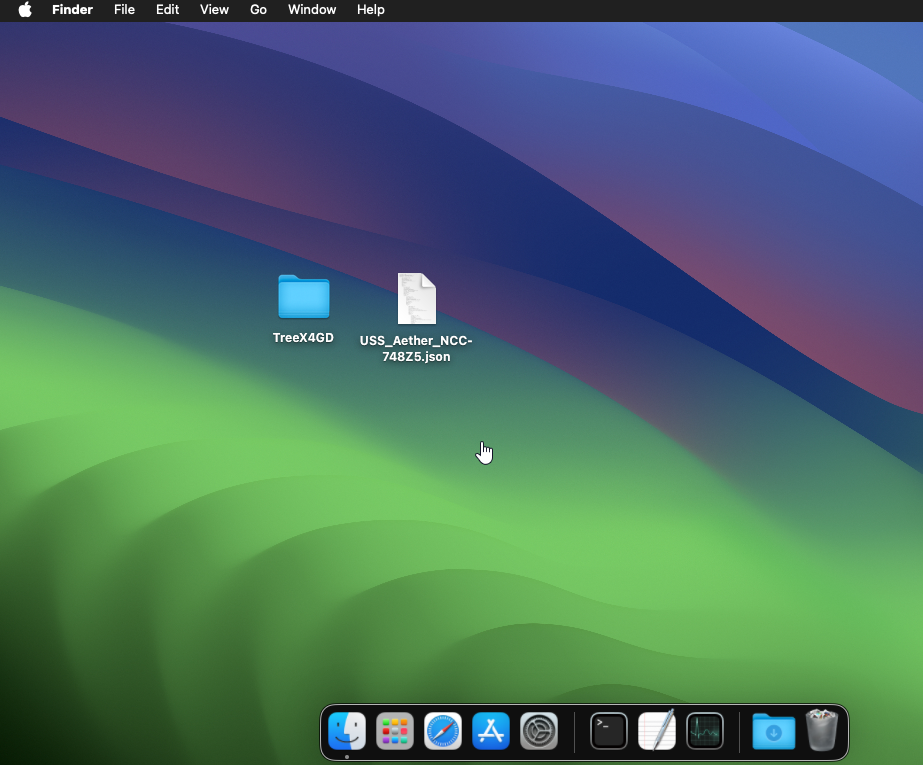

<!-- Document version 1.0.0 (revision 0 for TreeX4GD v1.0.x) -->

# TreeX4GD
File Tree Exporter for **Google Drive™**

## 1. Overview
TreeX4GD is a lightweight, open-source desktop tool designed to map your Google Drive into clean, easy-to-read reports. It complements the Google Drive web interface by providing capabilities it does not natively offer, such as hierarchical file trees and recursive folder size calculations.

With a single scan, you can generate an interactive HTML tree, a comprehensive Excel spreadsheet, and/or a JSON data backup. These formats simplify searching, visualizing, and navigating even the most complex directory structures, allowing you to archive all metadata for offline review and analysis.

---

## Table of Contents
* [2. Key Features](#2-key-features)
* [3. Technical Architecture & Performance](#3-technical-architecture--performance)
* [4. Setup & Installation](#4-setup--installation)
   * [Step 1: Install Python](#step-1-install-python)
   * [Step 2: Download & Extract](#step-2-download--extract)
   * [Step 3: First Launch (Automated Setup)](#step-3-first-launch-automated-setup)
   * [Step 4: Get Google Project Credentials](#step-4-get-google-project-credentials)
* [5. Usage Guide](#5-usage-guide)
* [6. Export Formats in Detail](#6-export-formats-in-detail)
   * [HTML Interactive Report](#html-interactive-report)
   * [Excel Spreadsheet (.xlsx)](#excel-spreadsheet-xlsx)
   * [Hierarchical JSON file](#hierarchical-json-file)
   * [Log Export (.txt)](#log-export-txt)
* [7. Building a Standalone Executable (optional)](#7-building-a-standalone-executable-optional)
* [8. Security Considerations](#8-security-considerations)
* [9. Project Background (The "Vibe Coding" Experiment)](#9-project-background-the-vibe-coding-experiment)
* [10. License & Disclaimer](#10-license--disclaimer)

---

## 2. Key Features
* **Metadata-Only:** TreeX4GD never downloads your files. It connects securely to the Google Drive API using read-only metadata permissions, retrieving only the information needed to map your Drive without accessing your file contents.
* **Complete Recursive Drive Mapping:** Generates a full hierarchical tree of any Google Drive folder, preserving the exact folder structure, nesting levels, and relationships between every file and directory.
* **Folder Size Calculation:** Calculates the true size of every folder by recursively summing the sizes of all descendant files — a capability not natively provided by Google Drive.
* **Multiple Export Formats:** Allows each scan to be exported as:
  * **Interactive HTML** for browsing, searching, expandable folder navigation, and direct Google Drive links.
  * **Excel (.xlsx)** for analysis, filtering, and reporting.
  * **Hierarchical JSON** for backup, automation, and offline re-importing to generate new HTML and Excel reports without rescanning Google Drive or consuming additional API quota.
  * **UTF-8 Log Files** for diagnostics and auditing.
* **Comprehensive Metadata Collection:** Captures extensive technical information including file sizes, owners, creation and modification dates, MIME types, version numbers, MD5 hashes (where available), shared status, hierarchy depth, parent relationships, and unique Google Drive IDs.
* **Natural Sorting:** Correctly sorts mixed text and numbers (e.g. *File 2* before *File 10*) and recognizes month names in multiple languages for intuitive ordering.
* **Smart URL Parsing:** Accepts either a Folder ID or a complete Google Drive URL, automatically extracting the required identifier regardless of additional URL parameters.
* **Shared Drives Support:** Works seamlessly with both personal **My Drive** folders and **Shared Drives** without requiring different workflows or additional configuration.
* **Responsive Background Processing:** Long-running scans execute on background threads, keeping the interface responsive while providing real-time progress logging, plus Pause, Resume, and Stop controls.
* **Efficient API Usage:** Uses request batching, rate limiting, and automatic exponential backoff to minimize API calls, reduce quota consumption, and gracefully recover from temporary Google API limits.
* **Cross-Platform Desktop Application:** Runs on Windows, macOS, and Linux, with platform-specific launchers that automatically create a virtual environment, install dependencies, and start the application.

## 3. Technical Architecture & Performance
* **Main Script:** The core application is a monolithic Python 3 script utilizing the standard `tkinter` library for its graphical interface. It employs an event-driven architecture with a strict separation of concerns between the UI and background tasks.
* **Performance:** To ensure the interface remains smooth and responsive during high-volume scans, all blocking network operations and file parsing run on background daemon threads. This prevents the application from "freezing" while data is being fetched.
* **Rate Limiting:** The app features a built-in API throttling technique, with exponential backoff and strategic sleep intervals. Also, by requesting large batches, it minimizes the total number of queries, protecting your daily quota and preventing Google API bans.
* **Memory & Scalability:** Data is stored in-memory using lightweight Python `dataclasses`. The application can comfortably handle hundreds of thousands of files on modern systems, though extremely massive drives (millions of files) are constrained by available local RAM.

## 4. Setup & Installation

### Step 1: Install Python
TreeX4GD requires Python 3.11 or newer.
* **Windows & macOS:** Download and install the latest Python version from the [official Python website](https://www.python.org/downloads/). On Windows, ensure you check the option to add Python to your system PATH during installation.
* **Linux:** Most Linux distributions come with Python pre-installed. The launcher script (`run_in_linux.sh`) will verify this, and if you are on a Debian/Ubuntu-based system, it will also attempt to automatically install missing core modules (like `python3-venv` and `python3-tk`). If you are on a different distribution, or prefer to handle it yourself, use your system's package manager (e.g., `sudo dnf install python3 python3-tkinter` for Fedora/RHEL, or `sudo apt install python3 python3-venv python3-tk` for Debian/Ubuntu).

### Step 2: Download & Extract
1. Go to the [GitHub Releases page](https://github.com/LuisMiCa/TreeX4GD/releases).
2. Download the appropriate archive for your operating system:
   * **Windows:** Download the `.zip` file.
   * **Linux / macOS:** Download the `.tar.gz` file (this format preserves the necessary script execution flags).
3. Extract the downloaded archive to a permanent location on your local machine.

### Step 3: First Launch (Automated Setup)
You do not need to manually configure Python virtual environments or hunt for dependencies. TreeX4GD includes dedicated launchers that handle the technical setup for you on the very first run.

Navigate into the `script/` subfolder and execute the script corresponding to your operating system:
* **Windows:** Double-click `run_in_windows.bat`
* **macOS:** Double-click `run_in_macOS.command`
* **Linux:** Double-click `run_in_linux.sh`. If your desktop environment prompts you, always select "Run in Terminal" (do not select "Run", as it will hide the installation progress). Alternatively, execute it directly from your terminal.

> **Note on First Launch:** The initial setup will take a few moments while it automatically verifies your Python installation, builds an isolated virtual environment (venv), and downloads the required packages listed in `requirements.txt`. Once this one-time process is complete, all subsequent launches will be significantly faster.

> **Note for macOS:** Because this project is distributed as source code rather than a signed application, on some macOS systems, the Gatekeeper may prevent the launcher from running. In many cases, you can bypass this by Control-clicking (or Right-clicking) `run_in_macOS.command` and selecting `Open`. If that doesn't work, open a `Terminal`, navigate to the extracted project folder, and run:  
> `xattr -dr com.apple.quarantine .`  
> This removes the quarantine attribute from all the extracted files. Afterwards, enter the `script/` folder and double-click `run_in_macOS.command` again (or run it from the terminal).

### Step 4: Get Google Project Credentials
TreeX4GD requires you to provide your own Google OAuth 2.0 application credentials file (`.json`). 

#### Why the "Bring Your Own Credentials" requirement?
I have intentionally chosen not to bundle "pre-authorized" project credentials. This is a deliberate design choice based on:

1. **Quota Independence (The "Bad Neighbor" Effect):** The Google Drive API has strict rate limits per project. If a single set of project credentials were used for everyone, one user running massive scans — or modifying the code in a way that inadvertently spikes API calls — could exhaust the daily quota for the entire user base. Using your own credentials gives you a dedicated quota, ensuring your app's performance is never affected by others.
2. **Inability to Securely Hide Credentials:** In a local desktop application, bundled credentials can never be truly hidden. They can be easily extracted by a malicious actor and used to abuse the Google API. This would lead to a "Project Ban" from Google, effectively breaking the app for every legitimate user. 
3. **Bypassing Verification and Testing Limits:** If I provided bundled credentials, the app would be initially placed in Google's "Testing" mode. This limits the app to 100 users, and I would have to manually whitelist the email address of everyone who wanted to test it. Removing this limit requires a formal Google App Verification — a complex, "black box" process designed for commercial SaaS software (requiring demo videos, a privacy policy hosted on a verified domain, and potential security audits). Since this is a hobby project, I am not willing to maintain that overhead. The "bring your own credentials" approach allows you to effortlessly self-verify for your own personal use.

#### Configuring Google Cloud Project and Getting Credentials
1. **Open:** [https://console.cloud.google.com/](https://console.cloud.google.com/)
2. **Create a new project:**
    * **2.1.** Open the **'Project Picker'** (in the top bar or `Ctrl + O`) and click **'New Project'**.
    * **2.2.** Write a name for the project. For example: `TreeX4GD` and click **'Create'**.
3. **Verify Project:** If you have other projects, make sure you're working on the right one (check the project picker).
4. **Activate Google Drive API:**
    * **4.1.** Open the **'Navigation Menu'** (top-left button) and navigate to **'APIs & Services'** --> **'Library'**.
    * **4.2.** Search for **"Google Drive API"**, click on it, and then click **'Enable'**.
5. **Create Credentials:**
    * **5.1.** Go to **'Navigation Menu'** --> **'APIs & Services'** --> **'Credentials'**.
    * **5.2.** Click **'+ Create Credentials'** and pick **'OAuth Client ID'**.
    * **5.3.** If not already configured, click **'Configure consent screen'**; otherwise, go to step **5.4**.
        * Click **'Get started'** and write the name of the app (I recommend `TreeX4GD - File Tree Exporter for Google Drive`).
        * Select the user support email address (your email) and click **'Next'**.
        * Select the **'Audience'**: If your account is within a Google Workspace, you might be able to use 'Internal' audience; otherwise, pick 'External' and click **'Next'**.
        > 💡 **Tip on Audience Selection:**
        > * **Internal (Workspace only):** Highly recommended if available. It bypasses "Unverified App" warnings, allows coworkers to log in *without* you having to manually whitelist their email addresses, and has no cap on the number of users.
        > * **External (Standard `@gmail.com`):** The app remains in "Testing mode," meaning you must manually add allowed emails to the **Test Users** list (Step 7) and there is a strict user limit (max 100).
        > 
        > **Note:** Either way, anyone using your configuration will need a copy of your `credentials.json` file to launch the app (think of it as a shared **App ID card**, not an account access key).
        * Enter your email in the **'Contact Information'**, click **'Next'**, agree to the policy and click **'Create'**.
        * Return to **'APIs & Services'** --> **'Credentials'** --> **'+ Create Credentials'** --> **'OAuth Client ID'**.
    * **5.4.** Select Application Type: **'Desktop App'**.
    * **5.5.** Pick a name for the application (for example, `TreeX4GD App`) and click **'Create'**.
    * **5.6.** Download the JSON file (save it to a secure location on your computer) and click **'OK'**.
6. **Add Scopes (Data Access):**
    * **6.1.** Go to **'Navigation Menu'** --> **'APIs & Services'** --> **'OAuth consent screen'**.
    * **6.2.** Click **'Data Access'** (on the left panel).
    * **6.3.** Click **'Add or remove scopes'**.
    * **6.4.** In the **'Filter'** box, type **'drive.metadata'**.
    * **6.5.** Pick **'.../auth/drive.metadata.readonly'** and check the box for that scope.
    * **6.6.** Click Update, then scroll to the bottom, and click Save.
    > **Note:** Any app using these credentials will only be able to read the files/folders metadata. If you do not set scopes in the Google Cloud Project, TreeX4GD will still work in test mode, but without the added security layer that prevents a modified script from requesting full access to download, edit, or delete your files (see *Security Considerations* below).
7. **Setting Test Users** (Required if you previously selected External Audience):
    * **7.1.** Go to **'Navigation Menu'** --> **'APIs & Services'** --> **'OAuth consent screen'**.
    * **7.2.** Click **'Audience'** (on the left panel).
    * **7.3.** Click **'Add users'**, enter your email and click **'Save'**.
    * **7.4.** (Optional) Add your friends' or coworkers' emails here (Gmail only). This allows them to use your credentials file without creating their own Google Cloud project.

## 5. Usage Guide

1. **Launch & Authenticate:** Run the launcher script for your OS. Click "**Select Credentials**" and point the application to your credentials `.json` file.
2. **Select Target Folder:** If you don't already have a Folder ID, click "**Browse Root**". Your browser will open to request access if needed; once authorized, navigate to your target folder in Google Drive and copy the URL from the address bar. Paste that URL (or just the ID) into the app's input field. Alternatively, click "**Set Root**" to automatically target your top-level "**My Drive**".
3. **Scan:** Click the **Start** button. If you haven't authenticated yet, your browser will open to request read-only access. Once authorized, the app will begin logging the file tree in real-time.
4. **Export:** Once the scan finishes (or is manually stopped), the export buttons will become available. Choose between HTML, Excel, or JSON formats to save the scanned metadata.

## 6. Export Formats in Detail
### HTML Interactive Report

* A high-performance, standalone HTML file with: 
    * **Virtual Scrolling:** Uses `Clusterize.js` to handle massive file lists without crashing your browser.
    * **Bulk Expand/Collapse:** Use intuitive Level Selectors in the header to instantly expand or collapse folders across the entire report based on their specific depth hierarchy (supports `Ctrl+Click` modifier).
    * **Individual Expand/Collapse:** Click explicitly on a folder's icon to expand or collapse that directory locally (also supports `Ctrl+Click` modifier).
    * **Interactive Links & Breadcrumbs:** Every file and folder name acts as a direct, clickable hyperlink that opens the corresponding item instantly in Google Drive. Clicking anywhere else on a row selects it, highlighting the row for clear tracking and generating a hierarchical breadcrumb trail in the top bar to maintain your context through deep folders.
    * **Advanced Local Search:** Features a powerful search engine supporting logical syntax (e.g., `>10MB`, `10MB..50MB`, `<2023`, `2020..2022`, `>21:45`). It also includes toggles for **Ignore Diacritics** (perfect for multilingual file names) and **Case Insensitivity**.
    * **Persistent Settings:** Remembers your Light/Dark mode, collapsed folders, and search preferences via browser `localStorage`.
    * **Visualization-Focused:** Optimized for structural browsing, displaying the visual tree and essential metadata (Names, Sizes, Types, Owners, and **Modified Dates**). For exhaustive data analysis and full metadata access, use the Excel export.
### Excel Spreadsheet (.xlsx)

* A comprehensive, granular data report designed for deep analysis and archiving, with:
    * **Clean Layout:** A structured table featuring frozen header rows and auto-adjusted column widths for instant readability.
    * **Interactive Hyperlinks:** Every entry includes a direct, clickable hyperlink on the file or folder name for instant access to that item directly on Google Drive.
    * **Exhaustive Metadata:** Captures a full technical snapshot of your cloud storage including the visual ASCII tree, exact sizes, file types, structural parent paths, hierarchy depth levels, ownership, last modifying editor, shared status, version history, MD5 hashes, and unique IDs—along with both Created and Modified dates (providing a significantly deeper data dive than the visualization-focused HTML report).
### Hierarchical JSON file
* A raw, lossless snapshot of the parsed file tree designed for data portability and backup, featuring:
    * **Offline Re-Importing:** Can be loaded back into the TreeX4GD application at any time using the "Import Data" button. This allows you to generate completely new HTML or Excel reports offline without rescanning the cloud or consuming any Google API quota.
    * **Lossless Architecture:** Preserves the exact nested tree hierarchy, full structural metadata, and local directory byte totals precisely as calculated during the scan.
    * **Automation & Script Friendly:** Uses a clean, programmatic JSON schema, making it effortless for developers to feed the data into custom analytics scripts.
### Log Export (.txt)
* A thorough chronological ledger of the entire scanning execution and background thread processes, providing:
    * **Detailed Diagnostics:** Records exact execution steps, real-time background worker tasks, folder processing milestones, and total scanned counts with precise timestamps.
    * **Troubleshooting & Error Logs:** Captures fine-grained network timeout alerts or Google API threshold rejections (`HttpError`), allowing you to instantly debug scan disruptions or identify issues.
    * **High-Fidelity Encoding:** Saved using standard UTF-8-BOM encoding to flawlessly preserve multi-language characters and structural logging icons (like 📂, 📄, and branch symbols).

## 7. Building a Standalone Executable (optional)
If you want to compile the source code into a standalone, portable executable binary so that **friends or coworkers** can run TreeX4GD without needing Python installed on their systems, follow the steps below.

### Platform-Specific Prerequisites & Execution Notes
* **macOS Requirement (Xcode Command Line Tools):** Building on macOS requires Apple's **Xcode Command Line Tools**. If they are not already installed on your system, executing the build script will automatically trigger the system prompt requesting installation. Keep in mind that this download is roughly 1 GB.
* **Linux Execution Prompt ("Run in Terminal"):** In desktop environments such as Linux Mint, double-clicking `build_for_linux.sh` presents options like *Run in Terminal*, *Display*, *Cancel*, and *Run*. **Always select "Run in Terminal"** (do not pick "Run"). Choosing "Run" executes the script silently in the background without any terminal output. If launched multiple times, concurrent instances will conflict with each other and cause build failures.

### Step-by-Step Instructions
1. **Prepare Your Environment:** Ensure you have already launched the application successfully at least once using your platform's automated launcher script — `run_in_windows.bat` (Windows), `run_in_macOS.command` (macOS), or `run_in_linux.sh` (Linux). This guarantees that PyInstaller and all core dependencies are properly downloaded and cached in your local virtual environment.
2. **Execute the OS-Specific Builder:** Navigate to the `builders/` folder and execute the builder script dedicated to your operating system:
   * **Windows:** Double-click `build_for_windows.bat`
   * **macOS:** Double-click `build_for_macOS.command`
   * **Linux:** Execute `build_for_linux.sh`:
     * *Linux Mint / Cinnamon / XFCE:* Double-click and choose **"Run in Terminal"**.
     * *Ubuntu / GNOME:* Right-click → **"Run as a Program"** (or launch via terminal with `./build_for_linux.sh`).
3. **Locate the Output:** Once compilation finishes, the standalone executable binary will be generated inside the `builders/TreeX4GD-build-output/` directory.
4. **(Optional) System Integration on Linux:** The Linux build process creates helper scripts (`install.sh` and `uninstall.sh`) inside the output folder. Running `./install.sh` adds TreeX4GD to your desktop application menu.
   > 💡 **Tip:** If the application does not immediately appear in your system's Applications list after executing `install.sh`, simply log out and log back in to force your desktop environment to refresh its application menu cache.

### Important Notes
* **Pre-built Binaries:** You may have noticed that there are no pre-compiled `.exe` or `.app` files provided in the GitHub Releases. This is a deliberate security decision (see [Security Considerations](#8-security-considerations)).
* **Help Documentation Access:** When running the standalone executable, PyInstaller unpacks assets to a temporary system folder. On macOS and Linux, modern browser security policies often block access to HTML files located within these restricted system paths entirely. To ensure the documentation is accessible, clicking "Help" copies the manual to your Downloads folder for viewing. These temporary files are automatically deleted when the application is closed. (On Windows, the documentation opens directly from the temporary folder without this workaround, as these specific browser restrictions do not apply.)

## 8. Security Considerations
Granting a third-party application access to your Google Drive can feel like a significant security risk — and rightfully so. Your cloud storage often contains sensitive personal, financial, or professional data.  

TreeX4GD is designed with a "Security through Transparency" philosophy. Because this is a local tool rather than a hosted service, you have full visibility into how your data is handled. This section outlines the specific choices made to ensure that your data remains yours, and yours alone:

* **Local Data Security:** All data processing happens strictly on your local machine. No data is sent to third-party servers, to the developer, or to anyone whatsoever.
* **Strictly Read-Only Scopes:** TreeX4GD explicitly requests the `https://www.googleapis.com/auth/drive.metadata.readonly` scope. By design, the application **cannot** read file contents, modify files, delete data, or upload files. It only retrieves the technical attributes—such as names, types, sizes, timestamps, ownership, and versions — needed to build an accurate map of your Drive. However, because Google Cloud is lenient when an app is in "Testing" mode, it will allow a script to request any scope if one isn't explicitly defined and restricted in the console. Without this restriction, the script could theoretically be modified to request full access to your Google Drive files. Therefore, ensure you lock down the scope when setting up your Cloud Project and generating credentials (see [Configuring Google Cloud Project and Getting Credentials](#configuring-google-cloud-project-and-getting-credentials) for more details).
* **Ephemeral Session Tokens:** TreeX4GD is designed with a "leave-no-trace" approach. While most Google Drive tools store a persistent "access key" on your disk to keep you logged in, this app holds your authentication in volatile memory (RAM) only. Closing the application instantly erases your session, ensuring no permanent "keys" to your Drive are left on your machine.
* **Use Only the Official Source:** To ensure your security, only download TreeX4GD from its [official GitHub repository](https://github.com/LuisMiCa/TreeX4GD). Avoid third-party mirrors or unofficial websites, and be especially cautious of pre-compiled executables (.exe or .app files) found anywhere, as these cannot be verified against the original source code.
* **No Bundled Binaries for Transparency:** I do not distribute pre-compiled executables on GitHub. Distributing binaries requires users to blindly trust that the `.exe` matches the open-source code. By forcing users to either run the Python scripts directly or build the executables themselves using the provided tools, maximum transparency and security are guaranteed.
* **Your data, your responsibility:** Keep in mind that any of the exported `.html`, `.xlsx`, and `.json`, as well as the log files, contain your complete folder structures, exact file names, and other details. Treat these exports as sensitive documents and do not share them publicly. Regarding the credentials file: while it does not allow direct access to your Google Drive, it contains the digital identity of your API connection and should be kept private to protect your API quota.
* **Interactive Report Storage**:
Each interactive HTML report you open will save some settings in the browser's localStorage, and if you collapse folders, it will also save the IDs of the hidden folders. This data is stored strictly on your machine and is not accessible by remote websites. But even if someone gains access to the IDs, they cannot use them to access your files **unless** they are already shared with "Anyone with the link".

## 9. Project Background (The "Vibe Coding" Experiment)
This project started as an experiment in "vibe coding" — building software with heavy AI assistance (relying entirely on free-tier AI tools). 

While I have a working knowledge of Python, web technologies (HTML/JS/CSS), and shell scripting — enough to handle the architecture, stitch the components together, and correct the logic — I am not an expert in any of them. Because of this, the bulk of the raw code generation was AI-driven. The core focus of this codebase is on practical functionality, reliability, and User Experience (UX), rather than rigid adherence to traditional coding aesthetics.

## 10. License & Disclaimer
**Copyright (c) 2026 Luís Carvalho**

This project is licensed under the **MIT License**. You are free to use, modify, and distribute this software, provided that the original copyright notice and [LICENSE](LICENSE) file are included.

**Disclaimer of Affiliation:**
TreeX4GD is an independent, open-source hobby project. It is not affiliated with, sponsored, or endorsed by Google LLC. "Google Drive" and any related marks are trademarks of Google LLC.

**"As-Is":**
As stated in the LICENSE file, this software is provided "as-is", without warranty of any kind. The author is not responsible for any data loss, API quota exhaustion, or account restrictions that may occur through the use of this tool. You are solely responsible for securing your data.